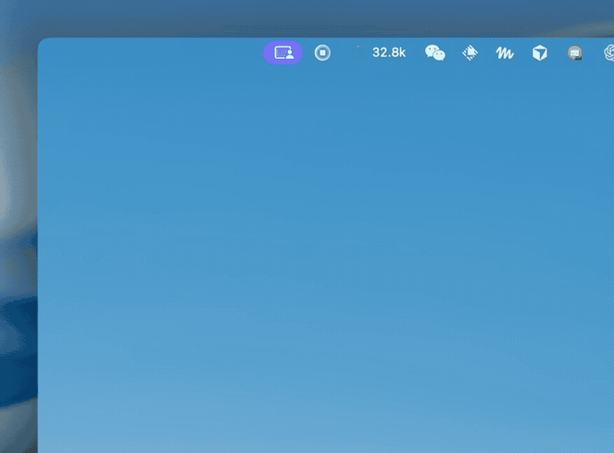

# agy-menubar

[English](README.md) | [简体中文](README_zh.md)

[](https://apple.com)
[](https://python.org)
[](https://github.com/kuhung/agy-menubar)
[](LICENSE)

Google Antigravity 本地菜单栏上下文容量与 Token 监控工具。

---

## 效果预览

<p align="center">
  
</p>

<details>
<summary><b>点击展开菜单项文本结构对照</b></summary>

```text
Mac 顶部状态栏:
[◎ 104.2k]  Tue Oct 19 14:50

点击下拉菜单:
┌──────────────────────────────────────────────┐
│ AI Model Quota Limits                        │
│ [■□□□□□□□□□□□]  10.4% (104,242 / 1M)        │
│ ──────────────────────────────────────────── │
│ 提示词缓存      102,005  (97.8%)             │
│ 本轮输入        2,237                        │
│ 剩余空间        895,758  (89.6%)             │
│ 当前模型        Gemini Flash                 │
│ ──────────────────────────────────────────── │
│ 切换跟踪会话                          ▶      │
│   ✓ 自动跟踪最新活跃会话                      │
│     AI Model Quota Limits                    │
│     多语言支持设计                           │
│ ──────────────────────────────────────────── │
│ 复制会话 ID                               ⌘C │
│ 在 Finder 中打开日志                       ⌘O │
│ 立即刷新                                   ⌘R │
│ 语言 / Language                       ▶      │
│   ✓ 跟随系统 (Auto)                          │
│     简体中文                                 │
│     English                                  │
│ ──────────────────────────────────────────── │
│ 退出                                       ⌘Q │
└──────────────────────────────────────────────┘
```

</details>

---

## 解决的问题

在 Antigravity 里做多轮编码或长任务时，官方界面不显示具体 Token 占用和上下文剩余量。经常写到一半模型反应变慢，才想起该敲 `/compact` 压缩上下文。

`agy-menubar` 常驻在 macOS 顶部菜单栏，读取本地落盘的会话记录，把 Token 使用情况和缓存命中率直接显示在右上角。

---

## 功能

- **动态进度环**：通过 CoreGraphics 在状态栏绘制 18×18 矢量环，按上下文占比显示绿、橙、红状态色。
- **Token 构成明细**：展开菜单可查看 Prompt Cache 缓存量、本轮输入、上轮输出、剩余可用空间与执行步数。
- **中英双语支持**：默认跟随 macOS 系统语言，支持在菜单中切换为简体中文或 English，也可通过 `--lang` 参数指定。
- **会话自动跟踪**：自动检测最新活跃会话，也可以在子菜单里手动固定特定会话。
- **快捷键**：支持键盘快捷键复制会话 ID、在 Finder 中定位日志文件、立即刷新以及退出。
- **本地读取**：只读访问本地 SQLite 数据库与运行日志，不发起网络请求，不修改本地配置。
- **系统守护进程**：支持配置 LaunchAgent 开机自启，占用极少内存和 CPU。

---

## 一键安装

在终端运行以下命令：

```bash
curl -fsSL https://raw.githubusercontent.com/kuhung/agy-menubar/main/install.sh | bash
```

安装脚本会执行以下步骤：
1. 检查 macOS 系统环境与 Python 3；
2. 安装可执行文件到 `~/.local/bin/agy-menubar`；
3. 创建并启动 `~/Library/LaunchAgents/com.kuhung.agy-menubar.plist`。

安装后菜单栏会直接出现进度环图标。

---

## 手动安装

克隆代码仓库后运行安装脚本：

```bash
git clone https://github.com/kuhung/agy-menubar.git
cd agy-menubar
./install.sh
```

如需在前台直接启动：

```bash
./bin/agy-menubar
```

指定界面语言启动：

```bash
./bin/agy-menubar --lang zh
./bin/agy-menubar --lang en
```

---

## 快捷键

点击菜单栏图标后，支持以下键盘操作：

| 快捷键 | 作用 |
|---|---|
| `⌘C` | 复制当前会话 ID 到剪贴板 |
| `⌘O` | 在 Finder 中打开当前会话日志目录 |
| `⌘R` | 立即重新读取本地数据并刷新 |
| `⌘Q` | 退出程序 |

---

## 卸载

在终端运行卸载命令：

```bash
curl -fsSL https://raw.githubusercontent.com/kuhung/agy-menubar/main/uninstall.sh | bash
```

脚本会停止并清理 LaunchAgent 服务，删除安装的二进制文件。

---

## 运行机制

```text
┌─────────────────────────────────┐
│     Antigravity 本地运行时      │
│  ~/.gemini/antigravity/         │
└───────┬─────────────────┬───────┘
        │ 读取活跃会话     │ 提取 Token 指标
        ▼                 ▼
 ┌───────────────┐ ┌──────────────────┐
 │ SQLite WAL 库 │ │ transcript.jsonl │
 └───────┬───────┘ └───────┬──────────┘
         │                 │
         └────────┬────────┘
                  ▼
   ┌────────────────────────────────┐
   │  Python + PyObjC 桥接          │
   │  (kCFRunLoopCommonModes, 1.5s) │
   └───────────────┬────────────────┘
                   │ CoreGraphics 矢量绘制
                   ▼
       顶部状态栏图标与实时数据
```

- **会话识别**：直连 `~/.gemini/antigravity/conversation_summaries.db`（SQLite WAL 只读模式），按修改时间排序。
- **数据解析**：读取会话的 `transcript.jsonl`，提取输入 Token、缓存命中 Token 与输出 Token。
- **状态缓存**：比对文件 `mtime` 和 `size`，内容无变动时不重复解析，降低资源消耗。
- **事件循环**：定时器注册在 `kCFRunLoopCommonModes`，展开菜单或拖动窗口时保持定时刷新。

---

## 许可协议

[MIT License](LICENSE) © 2026 [kuhung](https://github.com/kuhung)
